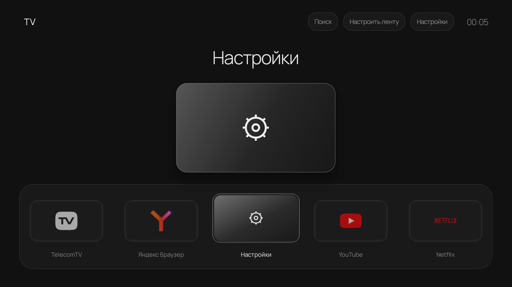

# Наш TV — спокойный главный экран для Android TV



**[Скачать APK](https://github.com/trsvar4i/tv-software/releases/latest/download/our-tv.apk)** · **[Все версии](https://github.com/trsvar4i/tv-software/releases)** · **[Сообщить об ошибке](https://github.com/trsvar4i/tv-software/issues)**

Наш TV — лёгкий лаунчер для телевизионных приставок: **однотонный тёмный фон → плавная цикличная лента → запуск приложения одним нажатием**. Крупная карточка показывает выбранное приложение, избранные стоят первыми, а настройки и поиск продолжают общий спокойный стиль.

Проект начался с Mi TV Stick 1080p, которому хотелось дать более отзывчивый и аккуратный рабочий стол. Интерфейс написан на Java с обычными Android View и Canvas, без WebView. Шрифт **Manrope** встроен в приложение и поддерживает кириллицу.

> Сейчас это экспериментальная версия **18.0**. Проверено на Mi TV Stick 1080p / MiTV-AESP0 с Android TV 10. Это замена главного экрана: приложения, прошивка и их собственные интерфейсы остаются прежними. Ускорение YouTube и других приложений не гарантируется.

---

## Содержание

- [Что внутри](#что-внутри)
- [Совместимость](#совместимость)
- [Как скачать приложение](#как-скачать-приложение)
- [Установка](#установка)
- [Сделать главным экраном](#сделать-главным-экраном)
- [Вернуть стандартный интерфейс](#вернуть-стандартный-интерфейс)
- [Обновление](#обновление)
- [Управление](#управление)
- [Если что-то не работает](#если-что-то-не-работает)
- [Данные и приватность](#данные-и-приватность)
- [Разработка](#разработка)
- [Структура проекта](#структура-проекта)

---

## Что внутри

### Рабочий стол

- **Цикличная лента:** после последнего приложения снова идёт первое.
- Выбранная карточка плавно увеличивается, кнопки и плитки получают мягкий градиент.
- Большая карточка по центру и название приложения над ней.
- Оригинальные иконки приложений с очисткой белой/чёрной подложки и светлых ореолов. Для некоторых сложных значков результат ещё может требовать доработки.
- Manrope Regular для подписей и кнопок, Light для заголовков и часов.
- Запуск по OK без дополнительного ожидания анимации. Переход использует миниатюру карточки; заставкой и временем загрузки стороннего приложения управляет само приложение.

### Своя лента

**«Настроить ленту»** позволяет закреплять приложения, менять порядок и скрывать лишнее. Закреплённые показываются первыми и отмечаются маленькой белой звездой. Есть отмена последнего изменения; настройки сохраняются между запусками.

**Поиск** находит установленные запускаемые приложения, включая скрытые из ленты и обычные Android APK. Учитываются распространённые русские названия, регистр и совпадение «ё/е». Наличие приложения в поиске не означает, что оно адаптировано для пульта.

### Настройки и работа в фоне

Своя панель настроек оформлена как рабочий стол. Из неё можно открыть Wi-Fi, Bluetooth, параметры экрана, звука и приложений. Глубокие системные страницы открываются в стандартных настройках Android.

Каталог и иконки готовятся в отдельном потоке, обработанные изображения кэшируются. При установке и удалении приложений список обновляется автоматически. Основное управление рассчитано на пульт; дополнительно поддерживаются указатель и перетаскивание.

---

## Совместимость

| Устройство | Статус |
|---|---|
| **Mi TV Stick 1080p, MiTV-AESP0, Android TV 10** | Проверено на реальной приставке |
| Xiaomi TV Stick 4K | Ожидается совместимость, требуется проверка |
| Mi Box / Mi Box S | Ожидается совместимость, требуется проверка |
| Другие приставки с Android TV / Google TV | Требуется проверка конкретной модели и прошивки |

Минимальная версия в APK — **Android 6.0 / API 23**, требуется TV-платформа с Leanback. Это технический минимум, а не подтверждение работы на каждой версии Android. Нативных библиотек, привязанных к одной архитектуре процессора, нет. Способ подключения ADB и выбор главного экрана зависят от прошивки.

4K-видеовыход сам по себе не мешает работе лаунчера; качество масштабирования и плавность на 4K-моделях пока не проверены. Как проверить свою приставку — в [плане тестирования](docs/TESTING.md).

---

## Как скачать приложение

1. Откройте **[Releases](https://github.com/trsvar4i/tv-software/releases/latest)**.
2. В блоке **Assets** скачайте **`our-tv.apk`** — это готовое приложение для приставки.
3. При желании скачайте `SHA256SUMS.txt` для проверки целостности.

Кнопки **Source code (zip / tar.gz)** и **Code → Download ZIP** скачивают исходники для разработчиков. Для обычной установки они не нужны. Компьютер используется для передачи APK; сам лаунчер работает на приставке, без постоянно включённого ПК.

Прямая ссылка на APK последнего выпуска:

```text
https://github.com/trsvar4i/tv-software/releases/latest/download/our-tv.apk
```

## Установка

### Вариант A — APK через файловый менеджер

1. Скачайте `our-tv.apk` из Releases и передайте файл на приставку удобным способом. На моделях с USB можно использовать флешку.
2. Откройте APK файловым менеджером на приставке.
3. Если Android запросит разрешение установки из неизвестного источника, разрешите его именно этому файловому менеджеру и повторите установку.
4. Откройте приложение **«Наш TV»** и проверьте ленту, поиск и запуск приложений.

Сначала попробуйте лаунчер как обычное приложение. Для этого не требуется отключать стандартный рабочий стол или получать root.

### Вариант B — с компьютера через ADB

Нужны компьютер, скачанный APK и **[Android SDK Platform-Tools](https://developer.android.com/tools/releases/platform-tools)**. Распакуйте Platform-Tools, положите `our-tv.apk` рядом с `adb.exe` и откройте PowerShell в этой папке.

На приставке откройте **Настройки → Об устройстве** и несколько раз нажмите на пункт сборки, пока не включится режим разработчика. Затем включите отладку в параметрах разработчика. Названия пунктов могут отличаться.

**Подключение по сети, если прошивка его поддерживает:** компьютер и приставка должны быть в одной локальной сети. Узнайте IP приставки в настройках сети и замените пример своим адресом:

```powershell
$tvAddress = "192.168.1.50:5555"  # пример: укажите адрес своей приставки
.\adb.exe connect $tvAddress
.\adb.exe devices
```

Подтвердите запрос отладки на телевизоре. В списке устройств должно быть состояние **`device`**, а не `unauthorized` или `offline`.

На проверенном Mi Stick включения «Отладки по USB» оказалось достаточно для подключения по сети, но это особенность его прошивки. Один переключатель USB-отладки не гарантирует сетевой ADB на других устройствах. Если есть «Беспроводная отладка» с кодом сопряжения, используйте адреса и порты из её экрана:

```powershell
.\adb.exe pair IP:ПОРТ_СОПРЯЖЕНИЯ
# Введите показанный на телевизоре код.
$tvAddress = "IP:ПОРТ_ПОДКЛЮЧЕНИЯ"
.\adb.exe connect $tvAddress
```

Порты сопряжения и подключения могут различаться. Если прошивка не даёт сетевой ADB, используйте установку APK через файловый менеджер либо поддерживаемое устройством USB-подключение. Подробности — в [документации ADB](https://developer.android.com/tools/adb).

**Установка и первый запуск:**

```powershell
.\adb.exe -s $tvAddress install -r .\our-tv.apk
.\adb.exe -s $tvAddress shell am start -n local.tv.lightlauncher/.MainActivity
```

Дождитесь `Success`. На macOS/Linux используйте соответствующие Platform-Tools и `./adb` вместо `.\adb.exe`.

## Сделать главным экраном

Если всё работает, нажмите **Home**. Если Android предложит выбор, укажите **«Наш TV» → «Всегда»**. На некоторых прошивках выбор находится в настройках приложений по умолчанию.

Через ADB можно попробовать:

```powershell
.\adb.exe -s $tvAddress shell cmd package set-home-activity --user 0 local.tv.lightlauncher/.MainActivity
.\adb.exe -s $tvAddress shell input keyevent 3
```

Проверьте кнопку Home и затем перезагрузку приставки. Если прошивка разрешает назначение HOME, Android открывает лаунчер как главный экран. На проверенном Mi Stick это работает; поведение Google TV и других прошивок ещё требует тестов.

**Автоматического отключения штатного лаунчера нет.** Если прошивка не разрешает замену, можно продолжать запускать «Наш TV» как приложение. Универсальной команды отключения системного экрана здесь нет: пакеты на разных моделях отличаются.

## Вернуть стандартный интерфейс

Выберите исходный рабочий стол в системных настройках приложений по умолчанию. Если он не отключён, можно удалить «Наш TV» через настройки приложений; Android вернётся к доступному штатному экрану или предложит выбор.

Если раньше вы вручную отключали штатный лаунчер, **сначала включите и восстановите его, затем удаляйте «Наш TV»**.

<details>
<summary>Команды для проверенного MiTV-AESP0 с Android TV 10</summary>

Здесь штатный пакет — `com.google.android.tvlauncher`. Эти команды не следует копировать на другие модели без проверки их исходного HOME-компонента.

```powershell
.\adb.exe -s $tvAddress shell pm enable --user 0 com.google.android.tvlauncher
.\adb.exe -s $tvAddress shell cmd package set-home-activity --user 0 com.google.android.tvlauncher/.MainActivity
.\adb.exe -s $tvAddress shell input keyevent 3
```

После появления стандартного экрана при желании удалите наш лаунчер:

```powershell
.\adb.exe -s $tvAddress uninstall local.tv.lightlauncher
```

</details>

## Обновление

Скачайте новый `our-tv.apk` из Releases и установите поверх старого: через файловый менеджер либо командой `adb install -r`. При совпадении подписи и допустимой версии настройки ленты сохраняются. Удалять старую версию перед обычным обновлением не нужно.

Если Android сообщает о несовпадении подписей, вы, вероятно, используете сборки от разных авторов или собственный ключ. Такие APK не обновляют друг друга напрямую. Удаление приложения стирает настройки; перед этим восстановите штатный HOME, если он был отключён.

## Управление

| Действие | Управление |
|---|---|
| Выбрать приложение | Влево / вправо на пульте |
| Открыть выбранное | OK |
| Перейти к поиску, редактору и настройкам | Вверх из ленты, затем стрелки |
| Закрыть панель / вернуться | Back; открытая клавиатура может закрыться первой |
| Вернуться на рабочий стол | Home, если «Наш TV» назначен главным экраном |
| Закрепить, скрыть или переместить | Кнопка «Настроить ленту» |

## Если что-то не работает

| Проблема | Что проверить |
|---|---|
| ADB: `unauthorized` | Подтвердите запрос на телевизоре |
| ADB: `offline` или нет подключения | IP, порт, отладку, общую сеть и поддержку сетевого ADB прошивкой |
| APK не устанавливается | Совместимость Android TV, свободное место, версию и подпись; для точной ошибки попробуйте ADB |
| Home открывает другой экран | Назначение приложения по умолчанию и ограничения прошивки |
| Приложения нет в ленте | Проверьте скрытые в редакторе и поиск; приложения без запускаемой Activity не выводятся |
| Обычный Android APK неудобен с пульта | Приложение может быть рассчитано на сенсорный экран |
| Иконка выглядит неправильно | Приложите название приложения и скриншот в Issue |
| YouTube долго загружается | Лаунчер меняет главный экран; загрузка и интерфейс YouTube зависят от самого приложения и устройства |

Для ошибки укажите модель приставки, Android, версию «Наш TV» и шаги воспроизведения. [План проверки новых устройств](docs/TESTING.md).

---

## Данные и приватность

Учётная запись и сервер не нужны. В манифесте нет разрешения на интернет; аналитика и рекламные SDK не подключены. Порядок, избранное, скрытые приложения и текущий выбор хранятся в локальных настройках, обработанные иконки — в кэше приложения. Очистка данных или удаление APK сбрасывает настройки. Сторонние приложения используют сеть и данные по своим правилам.

## Разработка

Стек: **Java 8, Android View / Canvas, Android SDK 34**, minSdk 23, targetSdk 28. Сборка — небольшой PowerShell-скрипт с ECJ и Android Build-Tools, без Gradle. Требуется Windows.

Инструменты и ключ подписи не входят в репозиторий. Подготовьте такую структуру:

```text
tools/
├── jre/<Java 17>/bin/java.exe        Java 17 с keytool
├── ecj.jar                         Eclipse Compiler for Java 3.38.0
├── build-tools/<версия>/            Android Build-Tools 34.0.0
│   ├── aapt.exe, d8.bat, zipalign.exe, apksigner.bat, ...
└── platform/android-34/android.jar  Android SDK Platform 34
```

Java можно взять у [Azul](https://www.azul.com/downloads/), ECJ — из [Eclipse JDT](https://download.eclipse.org/eclipse/downloads/), SDK Platform и Build-Tools — через [Android SDK Manager](https://developer.android.com/tools/sdkmanager). Поместите ровно одну используемую версию в каждый каталог: скрипт выбирает первый подкаталог. Файлы Build-Tools нужны целиком, включая их `lib/`.

```powershell
.\test.ps1    # проверки поиска и обработки иконок
.\build.ps1   # подписанный build/our-tv.apk
```

При первой сборке создаётся **локальный тестовый ключ** в `build/launcher.keystore`. Это не ключ официальных выпусков. Сохраняйте свой ключ для обновлений собственных сборок; не публикуйте keystore. Для обновления официального APK используйте APK из Releases с той же подписью.

Полноценный установщик для ПК и автоматическая подготовка сборочного окружения пока не реализованы. Сейчас пользователям доступен готовый APK и установка по инструкции выше.

## Структура проекта

```text
src/
├── MainActivity.java        рабочий стол, лента, панели, запуск и каталог
├── IconPixels.java          очистка подложки и краёв оригинальных иконок
└── SearchQuery.java         нормализация и поиск приложений
tests/
├── IconPixelsTest.java      регрессии обработки пикселей
└── SearchQueryTest.java     кириллица, алиасы и фильтрация
assets/fonts/
├── Manrope.ttf             встроенный шрифт
└── Manrope-OFL.txt         лицензия шрифта
docs/
├── images/home.png         реальный скриншот приставки
└── TESTING.md              проверка совместимости и отчёты об ошибках
AndroidManifest.xml         TV-приложение и обработчик HOME
build.ps1                   сборка и локальная подпись APK
test.ps1                    запуск Java-проверок
```

Manrope распространяется по [SIL Open Font License](assets/fonts/Manrope-OFL.txt); [исходник шрифта](https://github.com/google/fonts/tree/main/ofl/manrope). Названия и значки установленных приложений принадлежат их владельцам. Проект независимый и не связан с Xiaomi, Google или Apple.
